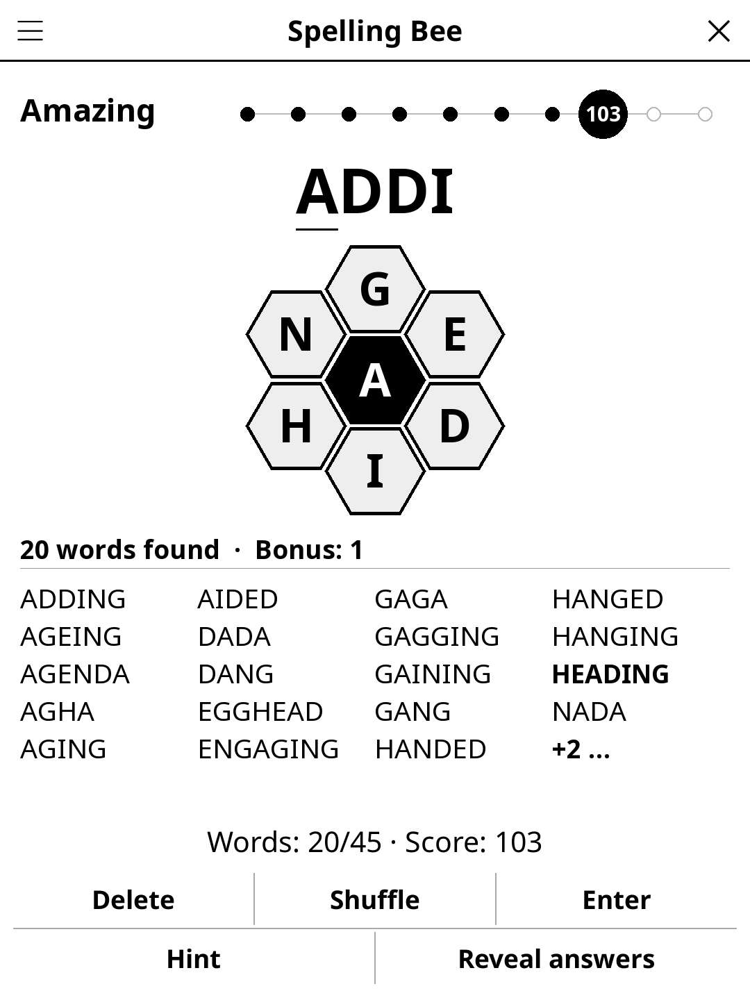

# spellingbee.koplugin

A Spelling Bee word game for [KOReader](https://github.com/koreader/koreader):
seven letters in a honeycomb, as many words as you can find.

## Screenshot

## Rules

Make words of at least 4 letters from the seven letters of the hive. Every
word must contain the centre letter; letters can be used more than once.
Every puzzle has at least one pangram, a word that uses all seven letters.

A 4-letter word scores 1 point, a longer word one point per letter, and a
pangram 7 points more. Your rank climbs Beginner, Good Start, Moving Up,
Good, Solid, Nice, Great, Amazing, Genius as a share of the puzzle's maximum
score; Queen Bee means every word found.

## Features

- **English and French** — follows KOReader's language by default, switchable
  from the menu. French accents are ignored (É is typed E), like the other
  word games.
- **Common words as answers** — a puzzle's answers are common words; rarer
  words the dictionary knows are still accepted as *bonus words*, shown in
  grey and worth no points, so Queen Bee never depends on obscure vocabulary.
- **No S**, as in the original: S would double every list with plurals.
- **Daily Challenge** — the same letters for everyone, all day.
- **Hint** — the first tap gives the start and length of a missing word, the
  second reveals it (no points for it).
- **Reveal answers** — ends the puzzle and greys in the words you missed.
- **Auto-save** — the current puzzle and your words are restored on next launch.

## Installation

1. Download `spellingbee.koplugin.zip` from the [latest release](../../releases/latest).
2. Extract into the `plugins/` folder of your KOReader data directory.
3. Restart KOReader.
4. Open the menu → **Tools** → **Spelling Bee**.

## Controls

| Action | How |
|--------|-----|
| Type a letter | Tap its hexagon |
| Remove the last letter | **Delete** |
| Check the word | **Enter** |
| Mix the outer letters | **Shuffle** |
| See every word found | Tap the word list, or **Word list** in the menu |
| Hint / give up | **Hint**, **Reveal answers** |
| Today's puzzle | **Daily Challenge** in the menu |

## Word lists

`words_<lang>.lua` and `puzzles_<lang>.lua` are generated by
`tools/build_words.py` from the dictionaries `boggle.koplugin` ships
(ENABLE, Public Domain, for English; a CC0 Scrabble-valid list plus
an-array-of-french-words, MIT, for French). Which words count as common comes
from the OpenSubtitles frequency lists of
[hermitdave/FrequencyWords](https://github.com/hermitdave/FrequencyWords)
(CC-BY-SA 4.0), top 30,000. Vulgar words and slurs are filtered out
(`tools/blocklist_<lang>.txt`). Puzzles keep 20 to 55 answers and a maximum
score of 240 at most.

## License

GPL-3.0 — see [LICENSE](LICENSE).
